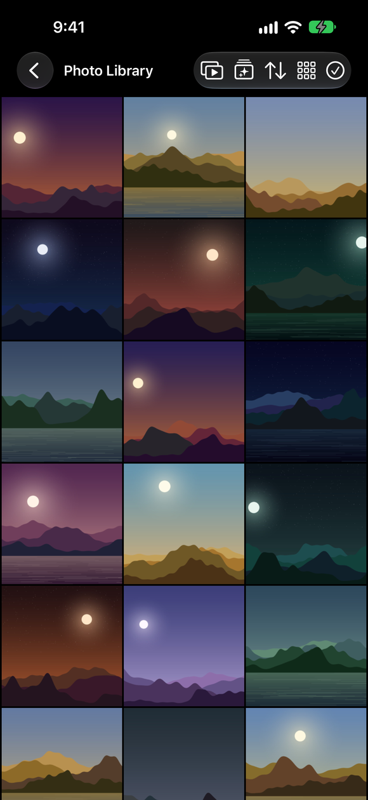
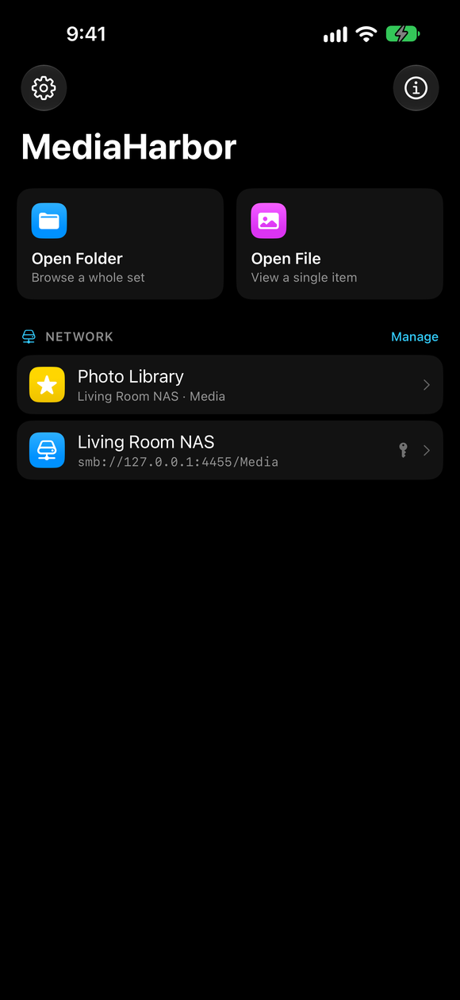
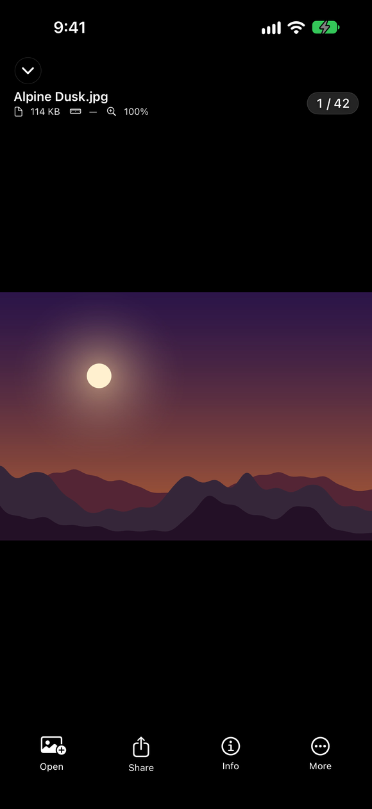
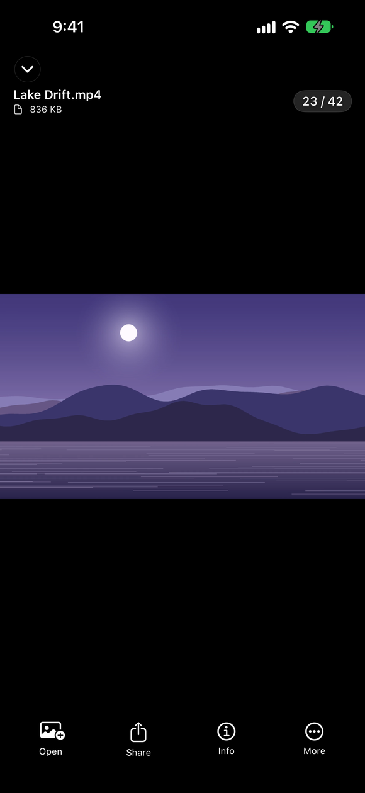
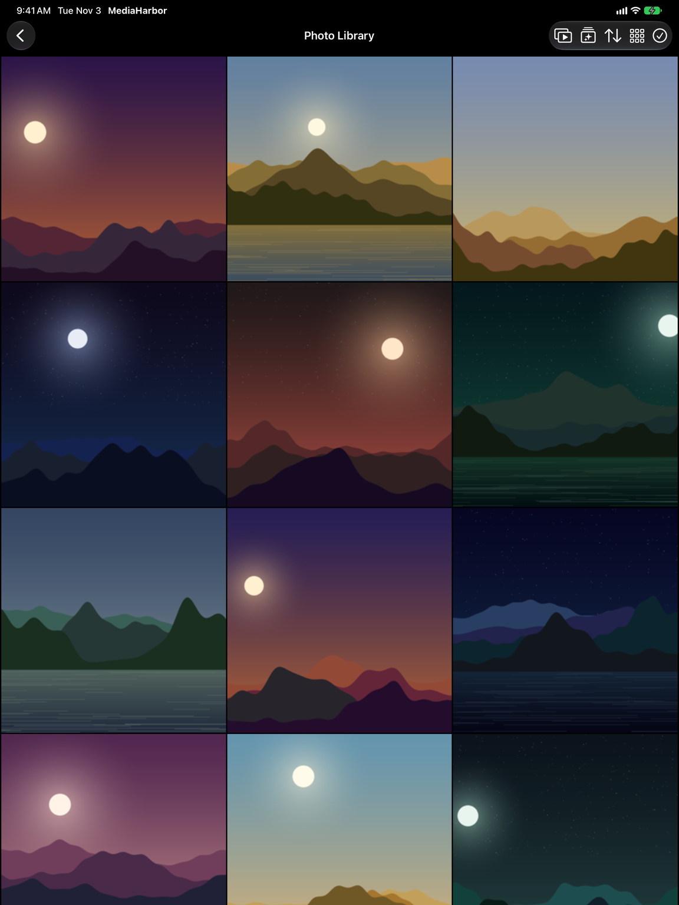
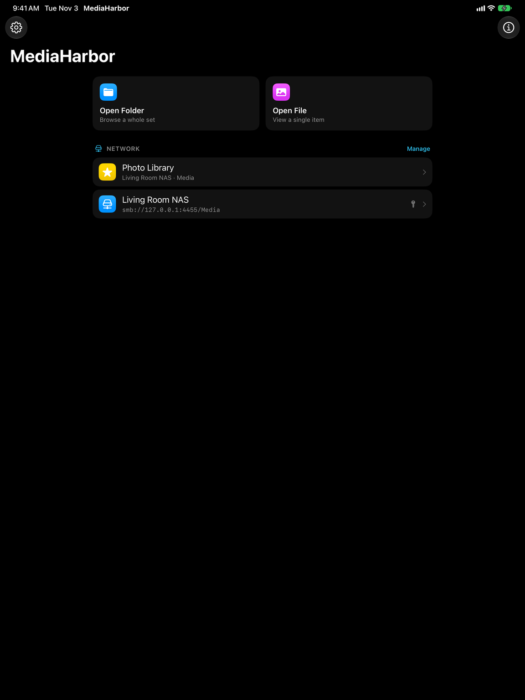
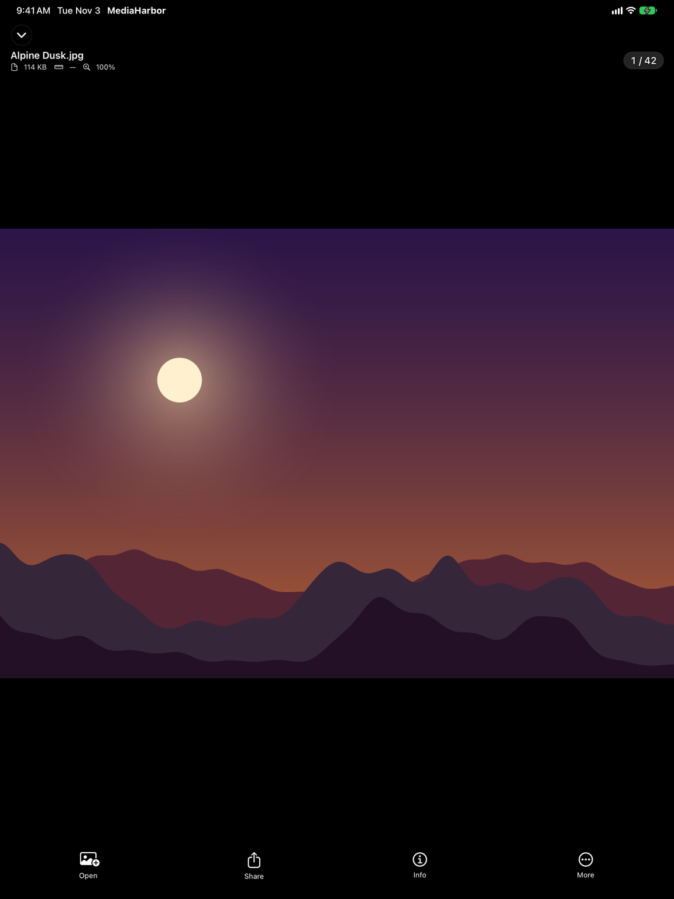
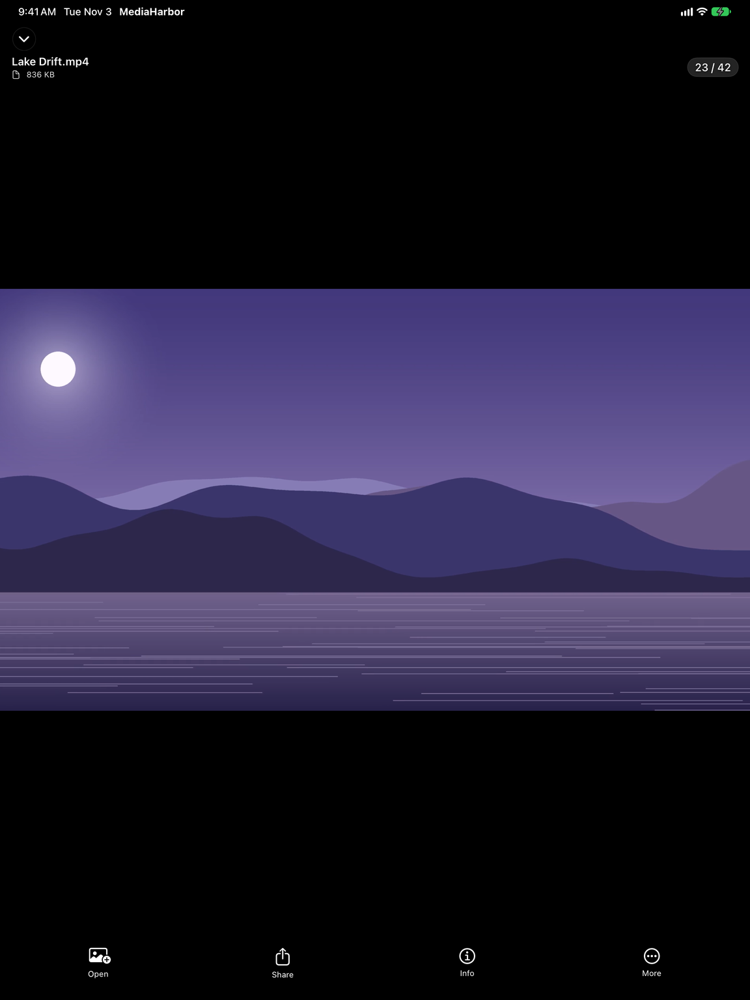




## Overview

Your photos and videos live on a NAS, an external drive, or right on your iPhone. **MediaHarbor** makes them feel like they're in the Photos app — without uploading a single file to anyone's cloud.

Save SMB connections to Synology, QNAP, TrueNAS, Unraid, or any Windows share and browse them directly. No mounting in the Files app first, no accounts, no sync service in the middle. Photos render in a fast thumbnail grid; video plays through a two-engine player that handles the MKV and AVI files iOS normally refuses to open.

MediaHarbor runs on iPhone, iPad, and Macs with Apple silicon, in English and German.




**Status:** {{ mh.status }} — submitted for App Store review. Check back shortly for the download link.
{: .notice--info }


<section class="feature-grid" aria-label="Feature highlights">
  

    <i class="fas fa-server" aria-hidden="true"></i>
    Direct SMB
    Connect straight to a NAS or Windows share — no Files app mount needed.
  

  

    <i class="fas fa-th" aria-hidden="true"></i>
    Real Photo Grid
    Adaptive thumbnails with file names, sorted by date taken, plus search and favorites.
  

  

    <i class="fas fa-images" aria-hidden="true"></i>
    Slideshows
    Start one from any gallery. It follows your filter or search and keeps the screen on.
  

  

    <i class="fas fa-film" aria-hidden="true"></i>
    MKV &amp; AVI Playback
    A built-in VLC engine plays what iOS can't open natively.
  

  

    <i class="fas fa-broadcast-tower" aria-hidden="true"></i>
    Stream, Don't Wait
    Video plays straight off the share, with no wait for a download.
  

  

    <i class="fas fa-download" aria-hidden="true"></i>
    Offline
    Download photos, videos, or whole folders and open them with no connection.
  

  

    <i class="fas fa-camera-retro" aria-hidden="true"></i>
    RAW &amp; Live Photos
    DNG, ARW, CR2, CR3, NEF, HEIC, GIF — plus Live Photo playback.
  

  

    <i class="fas fa-tv" aria-hidden="true"></i>
    PiP &amp; AirPlay
    Picture in Picture for every video, MKV and AVI included, and AirPlay for MP4 and MOV.
  

  

    <i class="fas fa-user-shield" aria-hidden="true"></i>
    Privacy First
    No accounts, no cloud, no trackers. Passwords stay in the Keychain.
  

  

    <i class="fas fa-map-marked-alt" aria-hidden="true"></i>
    Metadata &amp; Maps
    Full EXIF, GPS map view, and on-device scene detection.
  

</section>

## Screenshots

  <button type="button" class="device-tab is-active" data-target="iphone-pane" role="tab" aria-selected="true">iPhone</button>
  <button type="button" class="device-tab" data-target="ipad-pane" role="tab" aria-selected="false">iPad</button>

  

    <button type="button" class="carousel-btn carousel-prev" aria-label="Previous screenshots">&#8249;</button>
    

      <button type="button" class="carousel-thumb" data-full="/assets/images/mediaharbor-images/1.4/ios/ios-gallery.png" data-caption="Gallery — thumbnails straight from an SMB share, with Start Slideshow in the toolbar"></button>
      <button type="button" class="carousel-thumb" data-full="/assets/images/mediaharbor-images/1.4/ios/ios-home.png" data-caption="Home — saved connections and favorite folders"></button>
      <button type="button" class="carousel-thumb" data-full="/assets/images/mediaharbor-images/1.4/ios/ios-viewer.png" data-caption="Viewer — fitted to the screen, with file name, size, and zoom"></button>
      <button type="button" class="carousel-thumb" data-full="/assets/images/mediaharbor-images/1.4/ios/ios-player.png" data-caption="Video — streaming straight off the NAS"></button>
    

    <button type="button" class="carousel-btn carousel-next" aria-label="More screenshots">&#8250;</button>
  

  

    <button type="button" class="carousel-btn carousel-prev" aria-label="Previous screenshots">&#8249;</button>
    

      <button type="button" class="carousel-thumb" data-full="/assets/images/mediaharbor-images/1.4/ipad/ipad-gallery.png" data-caption="Gallery — the grid scales up on iPad"></button>
      <button type="button" class="carousel-thumb" data-full="/assets/images/mediaharbor-images/1.4/ipad/ipad-home.png" data-caption="Home — connections and favorites"></button>
      <button type="button" class="carousel-thumb" data-full="/assets/images/mediaharbor-images/1.4/ipad/ipad-viewer.png" data-caption="Viewer — a photo fitted to the screen, with its details"></button>
      <button type="button" class="carousel-thumb" data-full="/assets/images/mediaharbor-images/1.4/ipad/ipad-player.png" data-caption="Video — playback on iPad"></button>
    

    <button type="button" class="carousel-btn carousel-next" aria-label="More screenshots">&#8250;</button>
  

## Key Features

### Network Shares (SMB)

  - Save connections to Synology, QNAP, TrueNAS, Unraid, Windows shares, or any SMB server
  - Macs and NAS drives on your network show up by themselves when you add a connection
  - Direct SMB implementation — no need to mount the share in the Files app first
  - Host, port, username, domain, and default share are all configurable, and a default share opens directly
  - Passwords stored in the iOS Keychain, scoped to your device
  - Favorite individual folders for one-tap access from the home screen
  - Going back keeps your place in each folder
  - Files download only when you open them, and the local cache cleans up after itself

### Photo Browsing

  - Adaptive thumbnail grid, 2–6 columns, with pinch-to-resize and, if you like, each file's name under its thumbnail
  - A folder's subfolders appear above its photos, and each one opens on its own screen
  - Sort by name, date taken, or size, with date-grouped section headers
  - Search by file name, favorites, and multi-select for batch actions
  - Press and hold any thumbnail to share, copy, save to Photos, favorite, download, or see its info
  - JPEG, HEIC, PNG, GIF, TIFF, WebP, and RAW (DNG, ARW, CR2, CR3, NEF, ORF, RW2, RAF and more)
  - Live Photos play with a long press
  - Photos open fitted to the screen, or at their actual size if you prefer; pinch and double-tap to zoom
  - Start Slideshow from any gallery — slideshows follow your filter or search and keep the screen on
  - Smart albums from on-device scene detection — no photo ever leaves the device to be analyzed

### Video Playback

  - Two engines, chosen automatically: the native iOS player for MP4 and MOV, and a built-in VLC engine for MKV, AVI, WMV, TS, and other containers
  - Picture in Picture for every video, MKV and AVI included — with Play Next on, the next video carries on in the Picture in Picture window
  - AirPlay on the native player, and an AirPlay button for the sound of everything the VLC engine plays
  - Stream video straight off the share, or download it for offline playback
  - Continue Watching on the home screen, and every file resumes where you left off
  - Keeps playing in the background, with controls on the Lock Screen, in Control Center, and on your headphones
  - Double-tap to skip, hold for 2× speed, drag for brightness and volume
  - Play Next or Shuffle when a video ends, plus Loop Folder, Repeat One, and A-B loop
  - Audio and subtitle track selection, with preferred languages; `.srt` subtitle files load by themselves, even from a NAS
  - Subtitle size, color, and bold, and subtitle and audio sync in 0.25-second steps
  - Chapters, aspect ratio, Remember Speed, a Sleep Timer, and snapshots of any frame to Photos

### Offline

  - Download photos, videos, or a whole folder from your NAS and open them with no connection
  - Downloads stay until you remove them, and subtitles come along
  - Included in the free version

### iPad, Mac, and Accessibility

  - Full keyboard control and pointer support — Command-/ lists every shortcut
  - On a Mac with Apple silicon: menu bar commands and full keyboard control
  - VoiceOver reads each thumbnail's name and type, and Reduce Motion turns sliding animations into fades
  - In English and German

### Metadata

  - Full EXIF, TIFF, GPS, and IPTC data
  - Map view for photos with GPS coordinates
  - File name, size, dimensions, and format badges

### Privacy

  - No accounts, no ads, no third-party SDKs, no trackers
  - Nothing is uploaded — the app talks to your server and nobody else's
  - SMB passwords live in the iOS Keychain, device-scoped
  - The only data that ever reaches the developer: support messages you explicitly send, and anonymous usage statistics — app opens, purchases, which features get used each day, and crash reports, never your files or connections
  - In the EU, the EEA, the UK, and Switzerland, the app asks before it sends any statistics; anywhere, you can turn them off in Settings → Privacy (full details in the [privacy policy](/mediaharbor/privacy/))

## Pricing

MediaHarbor is a **free download**. The free version includes one saved network connection and plays the first five minutes of each video — enough to confirm it works with your NAS and your files before spending anything. Everything else, offline downloads included, has no limits.

A single **Lifetime Unlock** ($6.99, one time) removes both limits permanently. No subscription, and it's Family Shareable.

## Version History

<strong>v1.4.0 — November 2026</strong> <em>(Latest)</em>
  - **Deutsch** — MediaHarbor is now available in German
  - **Offline** — download photos, videos, or a whole folder from your NAS and open them with no connection; downloads stay until you remove them, and subtitles come along
  - **Folders** — a folder's subfolders appear above its photos and open on their own screens, going back keeps your place, Open File opens videos too, and a connection's default share opens directly
  - **Picture in Picture for every video** — MKV, AVI, and the rest included, plus an AirPlay button for their sound; with Play Next on, the next video carries on in the Picture in Picture window
  - **Slideshows** — a Start Slideshow button in the gallery; slideshows follow your filter or search and keep the screen on
  - **File names** — under each thumbnail, from the size menu or Settings
  - **Photos fit the screen** — or open at their actual size (Settings → Viewer → Open Images At)
  - **Date taken** — sorting by date uses when a photo was taken, not when the file was copied
  - **Video preferences** — subtitle size, color, and bold, preferred subtitle and audio languages, Remember Speed, and a Sleep Timer
  - **Mac and accessibility** — menu bar commands and full keyboard control on Macs with Apple silicon; VoiceOver reads each thumbnail's name and type, and Reduce Motion is honored
  - **Fixes** — no crash at launch with several videos in Continue Watching, the photo viewer's buttons respond again on iOS 27, and swiping across an MKV, AVI, or WebM video turns the page
  - **Privacy** — anonymous usage statistics now include which features get used each day, and crash reports; in the EU, the EEA, the UK, and Switzerland, the app asks first

<strong>v1.2.0 — October 2026</strong>
  - **Continue Watching** — the home screen lists the videos you're partway through, from your network shares or your folders
  - **Background playback** — videos keep playing when you lock the screen or switch apps, with controls on the Lock Screen, in Control Center, and on your headphones
  - **NAS discovery** — Macs and NAS drives on your network show up when you add a connection
  - **Item menus** — press and hold any thumbnail to share, copy, save to Photos, favorite, download, or see its info
  - **Snapshots** — save any video frame straight to Photos
  - **Tips** — hints for hidden gestures, and Command-/ lists every keyboard shortcut

<strong>v1.1.0 — September 2026</strong>
  - **Subtitles** — subtitle files load by themselves, even from a NAS, with a picker for others and subtitle and audio sync in 0.25-second steps
  - **Playback** — chapters, A-B loop, aspect ratio, Loop Folder, and Repeat One
  - **Keyboard and pointer** — full keyboard control, and pointer hover on iPad
  - **Anonymous usage counts** — app opens and purchases, with an off switch in Settings
  - **Also:** dozens of bug fixes

<strong>v1.0 — July 2026</strong>
  - Initial release: direct SMB browsing, photo grid with RAW and Live Photo support, two-engine video playback with streaming, resume positions, favorites, metadata with GPS maps, and on-device smart albums

## Open Source Notice

MediaHarbor includes open-source software: **VLCKit** (© VideoLAN and authors), **AMSMB2** (© Amir Abbas Mousavian), and **libsmb2** (© Ronnie Sahlberg and contributors), each used under the GNU LGPL v2.1 as dynamically linked, unmodified libraries. Full license text is included in the app under Settings → About → Third-Party Software.

## Privacy Policy

[Privacy Policy](/mediaharbor/privacy/)

## Support

Send feedback directly from inside the app — **About → Send Feedback**. No email account needed. You can also use the [Contact](/contact/) page.
