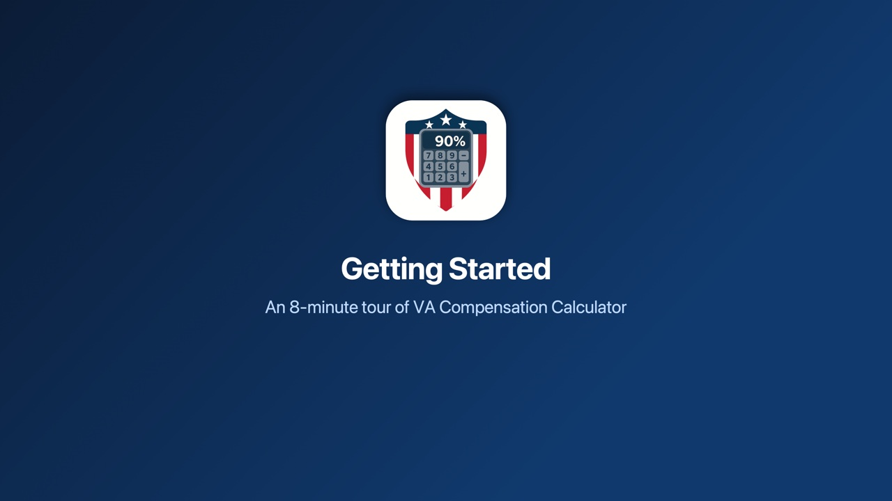

New to [VA Compensation Calculator](/va-compensation-calculator/)? This video walks through the whole app in about 8 minutes. It has captions, and the chapters below let you start with the part you need.

  <a class="vp-thumb" href="https://www.youtube.com/watch?v=f-iv8VpptRk" aria-label="Play the 8-minute Getting Started video">
    
    Watch the video · 8:11
  </a>

## In the video

<ul class="vp-chapters">
  <li>0:00 <a href="https://www.youtube.com/watch?v=f-iv8VpptRk" data-start="0">Welcome</a></li>
  <li>0:17 <a href="https://www.youtube.com/watch?v=f-iv8VpptRk&amp;t=17s" data-start="17">Where are you with VA?</a></li>
  <li>0:38 <a href="https://www.youtube.com/watch?v=f-iv8VpptRk&amp;t=38s" data-start="38">Add your rating</a></li>
  <li>1:11 <a href="https://www.youtube.com/watch?v=f-iv8VpptRk&amp;t=71s" data-start="71">Getting ready to file</a></li>
  <li>2:04 <a href="https://www.youtube.com/watch?v=f-iv8VpptRk&amp;t=124s" data-start="124">Your main screen</a></li>
  <li>2:29 <a href="https://www.youtube.com/watch?v=f-iv8VpptRk&amp;t=149s" data-start="149">Rating &amp; Pay</a></li>
  <li>3:12 <a href="https://www.youtube.com/watch?v=f-iv8VpptRk&amp;t=192s" data-start="192">My Disabilities</a></li>
  <li>3:35 <a href="https://www.youtube.com/watch?v=f-iv8VpptRk&amp;t=215s" data-start="215">My Profile</a></li>
  <li>4:10 <a href="https://www.youtube.com/watch?v=f-iv8VpptRk&amp;t=250s" data-start="250">Claim Finder</a></li>
  <li>4:52 <a href="https://www.youtube.com/watch?v=f-iv8VpptRk&amp;t=292s" data-start="292">Military Job Lookup</a></li>
  <li>5:28 <a href="https://www.youtube.com/watch?v=f-iv8VpptRk&amp;t=328s" data-start="328">Increase Finder</a></li>
  <li>5:53 <a href="https://www.youtube.com/watch?v=f-iv8VpptRk&amp;t=353s" data-start="353">Claim Tracker</a></li>
  <li>6:14 <a href="https://www.youtube.com/watch?v=f-iv8VpptRk&amp;t=374s" data-start="374">Symptom Log</a></li>
  <li>6:31 <a href="https://www.youtube.com/watch?v=f-iv8VpptRk&amp;t=391s" data-start="391">Calculators &amp; References</a></li>
  <li>7:03 <a href="https://www.youtube.com/watch?v=f-iv8VpptRk&amp;t=423s" data-start="423">Widgets and iPad</a></li>
  <li>7:24 <a href="https://www.youtube.com/watch?v=f-iv8VpptRk&amp;t=444s" data-start="444">Help when you need it</a></li>
  <li>7:48 <a href="https://www.youtube.com/watch?v=f-iv8VpptRk&amp;t=468s" data-start="468">Your information stays yours</a></li>
</ul>

Prefer to read? In the app, tap **?** and then **How to Use the App**.

Read the transcript

<h3>Welcome</h3>

Welcome to VA Compensation Calculator! See your combined rating and your monthly pay the way VA figures them. And find out what else you may be able to claim. Everything you enter stays on your device, and there's no account to make.

<h3>Where are you with VA?</h3>

The first time you open the app, it asks one question: where are you with VA? Already rated? Pick "I have a VA rating," and you'll start adding your disabilities. Getting ready to file? A few quick questions, then a list of what you may be able to claim. Just looking, or helping a veteran you know? That one takes you straight into the app.

<h3>Add your rating</h3>

Adding a disability takes seconds. Type its name, or tap the magnifying glass to search more than 700 diagnostic codes from VA's rating schedule. Pick the code on your decision letter, like DC 9411 for PTSD. The app fills in the name and suggests the usual ratings. Choose your rating and its status: rated, pending, or a claim you might file. Then tap Add. Both knees? Add each side and mark them bilateral, and the app applies VA's bilateral factor for you.

<h3>Getting ready to file</h3>

Getting ready to file? The app walks you through it. First, your job. Type the code from block 11 of your DD 214: an MOS, a rating, or an AFSC, even one retired decades ago. Its page shows what the job involved and the duties that came with it. Tap "This was my job." Next, where you served, like burn pits or the Gulf War. Then what you did. Your job's usual duties are already checked. Then you get one list: what VA presumes for where you served, what's linked to what you did, and the claims VA grants most often. Mark each one: I might file it, I've filed it, VA rated it, or VA denied it. Your answers go to My Profile, and what you mark goes to My Disabilities, so you can change any of it later.

<h3>Your main screen</h3>

This is your main screen. At the top: your combined rating and your monthly pay. VA doesn't add your ratings together. It combines them, then rounds to the nearest 10 percent. That's why 94 rounds to 90%. The yellow part of the ring shows what your pending claims could add. Below that, a card for each part of the app, and each card tells you where things stand before you open it.

<h3>Rating &amp; Pay</h3>

Tap "See why" to follow the math, step by step, in Rating &amp; Pay. Up top: your rating, your pay, and how close you are to the next rating. Here, one more point rounds up to 100%. Your pay, line by line: the rate for your rating and who it covers, then each added amount. And every step of the math, highest rating first. Each one takes its share of what's left of a whole person, as the bar shows. Have a pending claim, or one you might file? Switch it on to see what your rating and pay could be if VA grants it. Then share it as text or a PDF. Not sure where to start? Begin with My Disabilities and My Profile, then open the Claim Finder.

<h3>My Disabilities</h3>

My Disabilities keeps every condition with its rating, its status and its diagnostic code. Change a rating right from its row. Add notes, and log symptoms for that condition. And your highest ratings show right on the card, so you can see your list at a glance.

<h3>My Profile</h3>

My Profile is all about you. Add your dependents, your spouse, children and parents, and from a 30% rating up, your pay goes up to match. Set SMC and TDIU if VA granted them. Under Military service, add your jobs, where you served and what you did. That tells the Claim Finder what to show you first. Then tap "See what you may be able to claim" to turn it all into one list. And Share a summary puts it all in one document for your VSO: your claims, your rating and pay, your dependents and your service.

<h3>Claim Finder</h3>

The Claim Finder shows conditions you may be able to claim, and may not even know about. It looks in three places. First, conditions often claimed with the ones you have, like nerve problems that come with a back condition. Second, what you did in service, like loud noise, combat or asbestos, and the conditions linked to it. And third, where and when you served: Agent Orange, burn pits and the PACT Act, the Gulf War, Camp Lejeune and more. For those, VA presumes the connection to your service. Tap Add, and the main screen shows what your rating and pay could be if it's granted. And the lists update by themselves when a law or VA's own lists change.

<h3>Military Job Lookup</h3>

Military Job Lookup starts with the code on your DD 214. Type it the way your records print it, skill level and all. Older codes work too, even ones retired decades ago. You'll see what the job was, what it became, and the duties that usually came with it. Tap "This was my job" to keep it, and add its duties to what you did. The Claim Finder then shows the conditions linked to them. Back on the lookup, your jobs stay at the top. Every branch is covered, the Space Force included: more than 3,400 job codes.

<h3>Increase Finder</h3>

Already rated? The Increase Finder shows what the next rating step requires for each of your conditions. And what that one step would do to your combined rating and your monthly pay, using real VA math. They're sorted by what they'd add to your pay, so you can see which ones are worth a closer look. One heads-up: asking for an increase reopens the rating. Talk with a VSO first, and bring evidence.

<h3>Claim Tracker</h3>

The Claim Tracker keeps your claim on schedule. Add your C&amp;P exams, hearings, deadlines and decision dates, and get reminders before they happen. An intent to file holds your effective date, and your backpay, for one year. Set the day it runs out, and the app reminds you 30 days and one day before.

<h3>Symptom Log</h3>

The Symptom Log builds your evidence, one flare-up at a time. Log when it started, how long it lasted, and how bad it was. Over time, you get a summary in plain rating language, like how many prostrating migraines a month, to share with your VSO or your doctor.

<h3>Calculators &amp; References</h3>

Calculators and References has a tool for almost every question. The Backpay Calculator estimates your backpay across rating changes, month by month. The Pay Date Predictor estimates your first paid month and when it lands. What If lets you try different ratings without touching your real list. And there's more: an SMC screener, a TDIU check, CRDP and CRSC for retirees, and every 38 CFR diagnostic code.

<h3>Widgets</h3>

Add the widget to your Home Screen or Lock Screen for your rating, your pay, your next pay date and your next claim event, at a glance. With App Lock on, it shows a lock instead of your numbers.

<h3>iPad</h3>

On iPad, your rating and cards stay on the left, and what you open appears right beside them. Tap another card, and it opens in its place.

<h3>Help when you need it</h3>

Tap the question mark at the top of a screen to jump straight to the help for it. Support and Community puts the Veterans Crisis Line first, then free help with your claim, your health, family, housing and work. Every number and link is checked. Questions or ideas? Tap Contact Me. News keeps you posted on things like the cost-of-living adjustment and VA changes.

<h3>Your information stays yours</h3>

Everything you enter stays on your device, protected by its encryption. Your disabilities, ratings and notes never leave it. Back it all up to a file whenever you like, and lock the app with Face ID. VA Compensation Calculator: your rating, your pay, and what you may be able to claim. The numbers are estimates, and the app isn't affiliated with VA.

The numbers in the app are estimates, not official VA figures. VA Compensation Calculator isn't affiliated with the U.S. Department of Veterans Affairs.

