

## Overview

Calculate VA disability compensation, find what else you may be able to claim, track your claim journey, and explore "what if" scenarios — all on your device, with zero ads and no account required.

Built by a veteran for veterans. Includes 14 focused calculators and references (among them the Claim Finder, Military Job Lookup and Survivor Benefits), a Claim Tracker with reminders, the full 38 CFR Part 4 schedule (700+ diagnostic codes with per-percentage rating criteria), and PDF export for handing off to VSOs or attorneys. For iPhone and iPad, with an Apple Watch app and widgets for your Home Screen and Lock Screen. Free forever. Supported by an entirely optional Tip Jar — tipping unlocks nothing.

New here? [Watch the 8-minute Getting Started video](/va-compensation-calculator/getting-started/).

<section class="feature-grid" aria-label="Feature highlights">
  

    <i class="fas fa-calculator" aria-hidden="true"></i>
    Combined Rating
    Accurate math per 38 CFR 4.25 and the bilateral factor, each step shown in Rating &amp; Pay.
  

  

    <i class="fas fa-chart-line" aria-hidden="true"></i>
    Monthly Compensation
    10 years of rate tables (2018–2027) with full dependent support.
  

  

    <i class="fas fa-search-plus" aria-hidden="true"></i>
    Claim Finder
    Conditions you may be able to claim, from your conditions, service and duties.
  

  

    <i class="fas fa-id-card" aria-hidden="true"></i>
    Military Job Lookup
    The job code on your DD 214: what the job was, what it became, its duties.
  

  

    <i class="fas fa-user-circle" aria-hidden="true"></i>
    My Profile
    Dependents, SMC, TDIU and your military service, with a summary to share.
  

  

    <i class="fas fa-hand-holding-heart" aria-hidden="true"></i>
    Survivor Benefits
    What VA's DIC would pay your spouse and children, and when it would apply.
  

  

    <i class="fas fa-history" aria-hidden="true"></i>
    Backpay Calculator
    Retroactive pay across rating timelines, with PDF export.
  

  

    <i class="fas fa-level-up-alt" aria-hidden="true"></i>
    Increase Finder
    What the next rating step requires per condition, and what it's worth.
  

  

    <i class="fas fa-calendar-check" aria-hidden="true"></i>
    Claim Tracker
    Track C&amp;P exams, hearings, and deadlines with reminders.
  

  

    <i class="fas fa-notes-medical" aria-hidden="true"></i>
    Symptom Log
    Log episodes over time and share a claim-language summary with your VSO.
  

  

    <i class="fas fa-stopwatch" aria-hidden="true"></i>
    Apple Watch
    Your rating and pay on your wrist; log an episode the moment it starts.
  

  

    <i class="fas fa-mobile-alt" aria-hidden="true"></i>
    Widgets
    Your rating, pay and next pay date on your Home Screen and Lock Screen.
  

  

    <i class="fas fa-book-medical" aria-hidden="true"></i>
    38 CFR Diagnostic Codes
    Full 38 CFR Part 4 schedule — 700+ codes with per-band rating criteria.
  

  

    <i class="fas fa-th-large" aria-hidden="true"></i>
    Tools &amp; Calculators
    What If?, SMC Screener, Pay Date Predictor, COLA Estimator, CRDP/CRSC, more.
  

  

    <i class="fas fa-file-export" aria-hidden="true"></i>
    Backup &amp; Restore
    Everything in one file you keep — restore it on a new phone.
  

  

    <i class="fas fa-lock" aria-hidden="true"></i>
    Privacy First
    All-local storage, Face ID lock, no accounts, no ads.
  

</section>

## Screenshots

  <button type="button" class="device-tab is-active" id="iphone-tab" role="tab" aria-selected="true" aria-controls="iphone-pane">iPhone</button>
  <button type="button" class="device-tab" id="ipad-tab" role="tab" aria-selected="false" aria-controls="ipad-pane" tabindex="-1">iPad</button>
  <button type="button" class="device-tab" id="watch-tab" role="tab" aria-selected="false" aria-controls="watch-pane" tabindex="-1">Apple Watch</button>

  

    <button type="button" class="carousel-btn carousel-prev" aria-label="Previous screenshots">&#8249;</button>
    

      <figure class="shot">
        <button type="button" class="shot-thumb" data-caption="The main screen: your rating and pay up top, your tools as cards below">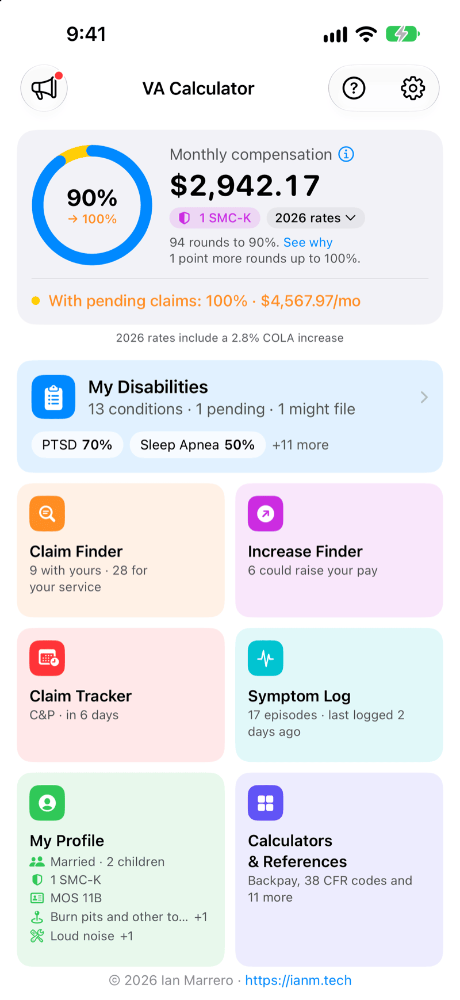</button>
        <figcaption>Main screen</figcaption>
      </figure>
      <figure class="shot">
        <button type="button" class="shot-thumb" data-caption="Rating &amp; Pay: your pay line by line, and how your ratings combine, step by step">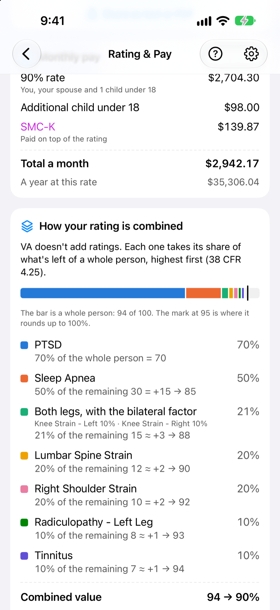</button>
        <figcaption>Rating &amp; Pay</figcaption>
      </figure>
      <figure class="shot">
        <button type="button" class="shot-thumb" data-caption="Claim Finder: conditions often claimed with the ones you have">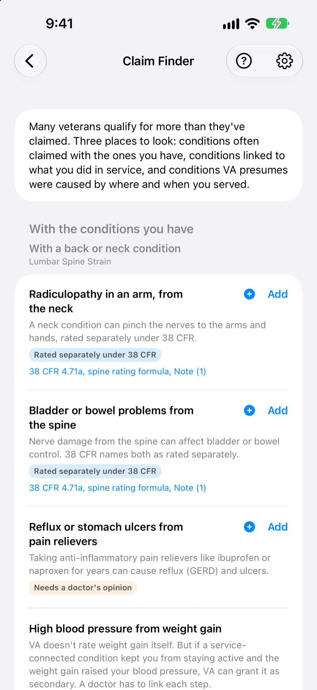</button>
        <figcaption>Claim Finder</figcaption>
      </figure>
      <figure class="shot">
        <button type="button" class="shot-thumb" data-caption="Military Job Lookup: what the job was, its earlier codes, and what was often part of it">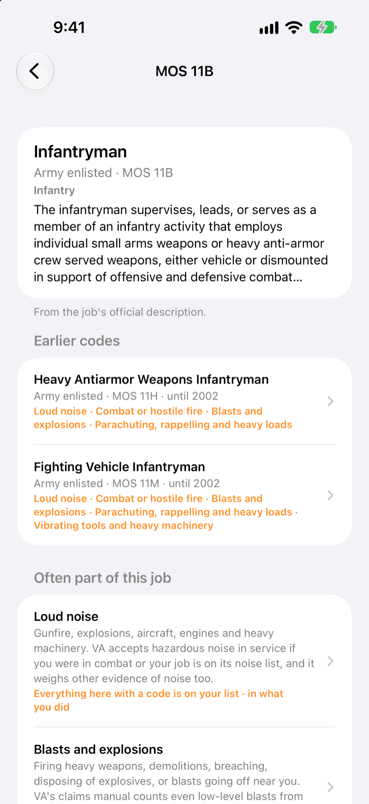</button>
        <figcaption>Military Job Lookup</figcaption>
      </figure>
      <figure class="shot">
        <button type="button" class="shot-thumb" data-caption="My Profile: Dependents, SMC &amp; TDIU, and Military service in one place">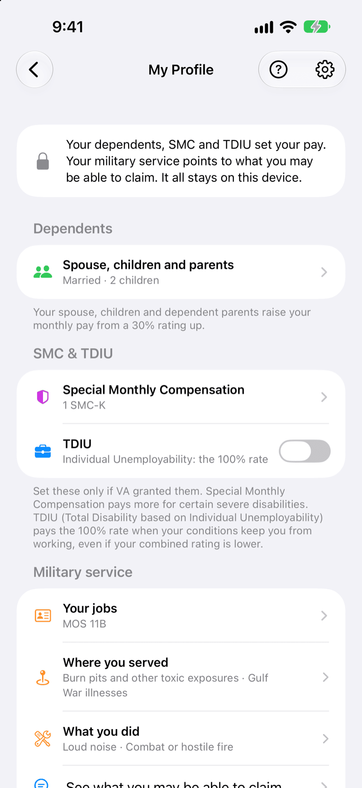</button>
        <figcaption>My Profile</figcaption>
      </figure>
      <figure class="shot">
        <button type="button" class="shot-thumb" data-caption="Share a summary: pick what goes in, then share it as text or a PDF">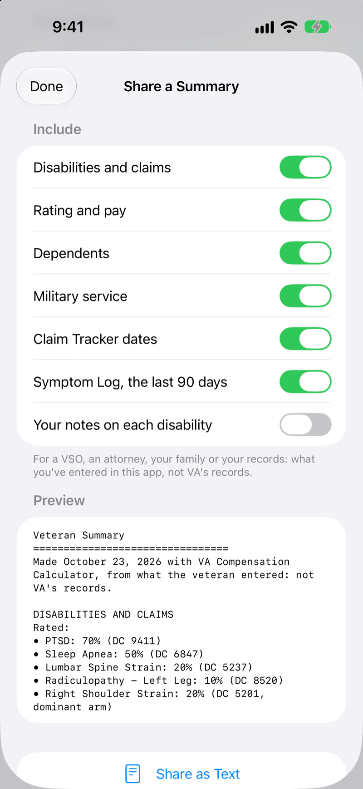</button>
        <figcaption>Share a summary</figcaption>
      </figure>
      <figure class="shot">
        <button type="button" class="shot-thumb" data-caption="Survivor Benefits, For your family: what your spouse and children could receive, line by line">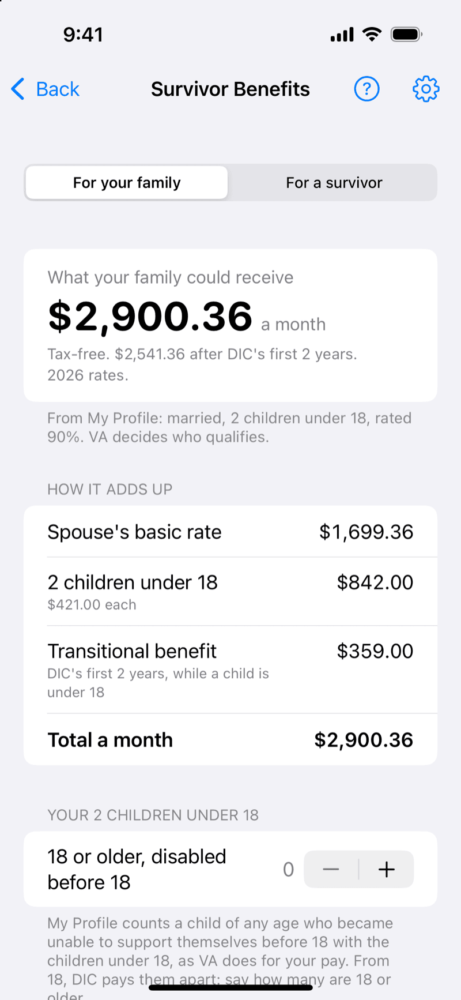</button>
        <figcaption>Survivor Benefits: for your family</figcaption>
      </figure>
      <figure class="shot">
        <button type="button" class="shot-thumb" data-caption="Survivor Benefits: when each of VA's rules would apply">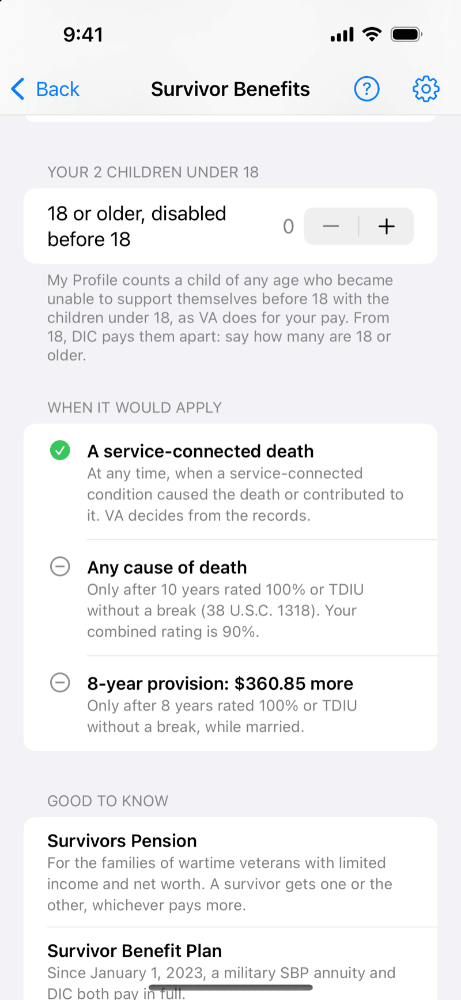</button>
        <figcaption>Survivor Benefits: when it would apply</figcaption>
      </figure>
      <figure class="shot">
        <button type="button" class="shot-thumb" data-caption="Survivor Benefits, For a survivor: an estimate from the survivor's own answers">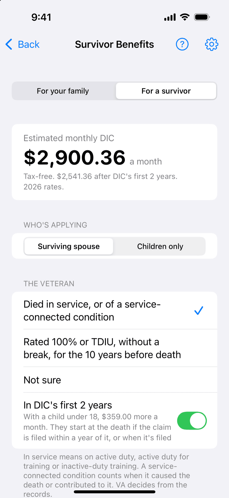</button>
        <figcaption>Survivor Benefits: for a survivor</figcaption>
      </figure>
      <figure class="shot">
        <button type="button" class="shot-thumb" data-caption="Widgets on your Home Screen: your rating, pay, next pay date and next Claim Tracker date">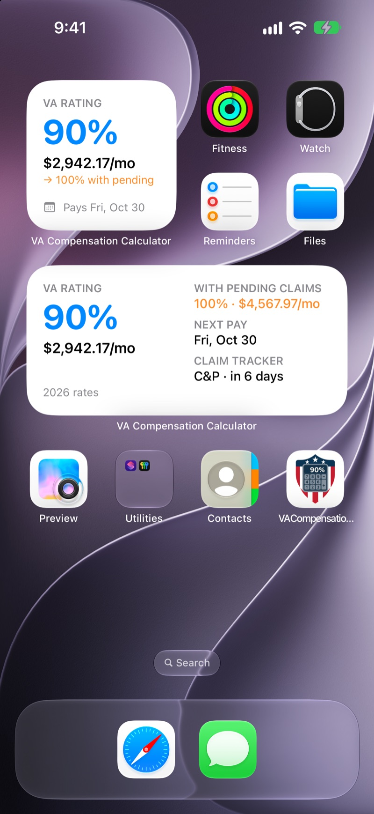</button>
        <figcaption>Home Screen widgets</figcaption>
      </figure>
      <figure class="shot">
        <button type="button" class="shot-thumb" data-caption="Widgets on your Lock Screen">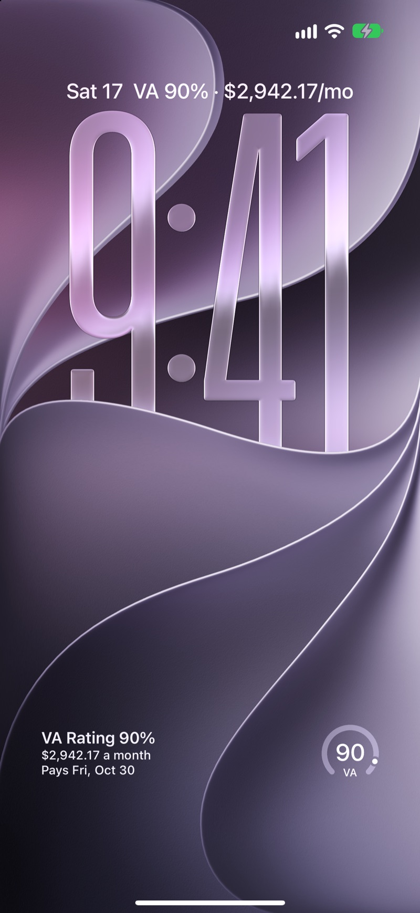</button>
        <figcaption>Lock Screen widgets</figcaption>
      </figure>
    

    <button type="button" class="carousel-btn carousel-next" aria-label="More screenshots">&#8250;</button>
  

  

    <figure class="shot">
      <button type="button" class="shot-thumb" data-caption="iPad: your rating and cards on the left, each card's screen beside them">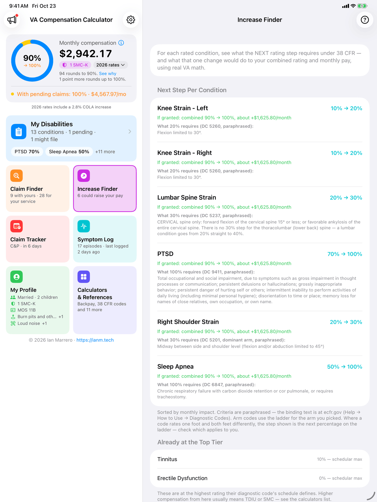</button>
      <figcaption>iPad: two columns</figcaption>
    </figure>
  

  

    <button type="button" class="carousel-btn carousel-prev" aria-label="Previous screenshots">&#8249;</button>
    

      <figure class="shot">
        <button type="button" class="shot-thumb" data-caption="Apple Watch: your rating and monthly pay">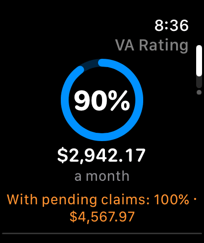</button>
        <figcaption>Your rating and pay</figcaption>
      </figure>
      <figure class="shot">
        <button type="button" class="shot-thumb" data-caption="Apple Watch: timing a migraine for the Symptom Log">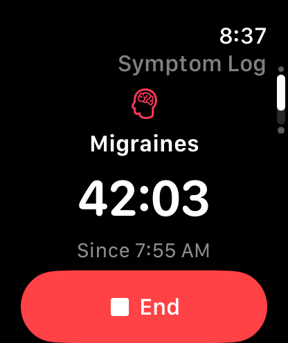</button>
        <figcaption>Timing a migraine</figcaption>
      </figure>
      <figure class="shot">
        <button type="button" class="shot-thumb" data-caption="Apple Watch: when it ends, how bad it was">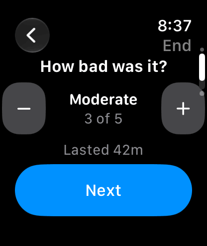</button>
        <figcaption>How bad was it?</figcaption>
      </figure>
      <figure class="shot">
        <button type="button" class="shot-thumb" data-caption="Apple Watch: your Claim Tracker dates">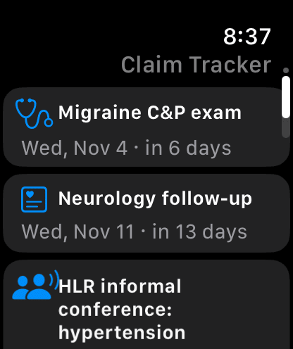</button>
        <figcaption>Claim Tracker</figcaption>
      </figure>
    

    <button type="button" class="carousel-btn carousel-next" aria-label="More screenshots">&#8250;</button>
  

## Key Features

### Combined Rating & Monthly Compensation
  - Combined disability rating per 38 CFR 4.25
  - Bilateral factor per 38 CFR 4.26, including 4.26(d): a condition is left out of the factor when that gives a higher rating
  - Rating & Pay — each step of how your ratings combine, your pay line by line, and what would reach the next rating, with switches to add your pending claims or the claims you might file
  - Monthly compensation across 10 years of rate tables (2018–2027), each with its COLA; new tables arrive without an app update, and the rate year moves to the new rates on December 1 by itself
  - Full dependent support — spouse, spouse Aid & Attendance, dependent parents, children under 18, children 18–23 in school
  - Projected rating with your pending claims, and with the claims you might file
  - Rounding note beside your rating — "94 rounds to 90%", and how many points more would round up — with Rating & Pay one tap away

### Claim Finder
  - Conditions often claimed with the ones you have, matched by diagnostic code — some rated separately under 38 CFR, like the complications of diabetes and nerve problems from the spine; others need a doctor's opinion
  - Conditions VA presumes are service-connected after certain service — Agent Orange, burn pits and the PACT Act's other exposures, Gulf War illnesses, Camp Lejeune, radiation, former prisoners of war and more
  - Conditions linked to what you did in service — loud noise, combat, blasts, asbestos, diving and more — with what VA accepts as proof of the duty; these aren't presumptions
  - Each condition cites its 38 CFR section or VA page; Add puts it on your list as a claim you might file, and the main screen shows what it could mean for your rating and pay
  - The lists update without an app update when a law or VA's lists change, and each update is signed

### Military Job Lookup
  - The job code from block 11 of your DD 214 — an MOS, rating or AFSC — or its title, in every branch, the Space Force included
  - More than 5,000 job codes, today's and older ones, many retired decades ago; type the code the way your records print it, skill level and all (11B1P, BM2, 2A571), or browse by branch and career field
  - A job's page — its official description, what it became or what came before it, the duties often part of it, and, for jobs on VA's own asbestos list, the exposure level VA's manual gives the job
  - "This was my job" keeps it in My Profile, and its duties go into what you did in the Claim Finder
  - The lists update without an app update

### My Profile
  - Your dependents, SMC and TDIU, and your military service — your jobs, where you served and what you did — in one place
  - "See what you may be able to claim" turns your answers into one list to go through, and you mark each one as you go: might file, filed, rated or denied
  - Share a summary — your disabilities and claims, rating and pay, dependents, military service, Claim Tracker dates and Symptom Log in one document, as text or a PDF, for a VSO or anyone you choose

### Survivor Benefits (DIC)
  - Estimates Dependency and Indemnity Compensation, the tax-free monthly payment VA makes to a veteran's surviving spouse and children, line by line from VA's rates
  - For your family — from the dependents in My Profile, with when each rule would apply: a service-connected death at any time; almost any cause of death after 10 years rated 100% or TDIU without a break (5 from the day you left active duty, 1 as a former prisoner of war); and the 8-year provision, which pays a spouse more
  - For a survivor — an estimate from the survivor's own answers, with VA's rules for who qualifies and a link to apply on VA.gov
  - An estimate only: it never says anyone qualifies, since VA decides; it leaves out parents' DIC (income-based) and deaths before 1993
  - A new year's rates arrive without an app update; the dates you add stay on your device

### Backpay Calculator
  - Retroactive compensation across timelines of rating changes and life events, like a marriage or a new child
  - Handles COLA boundary transitions automatically
  - 38 CFR 3.31 full-month rule applied correctly
  - Future-date projection for awards still pending
  - "Already being paid at" offset — an increase shows only the difference owed, including any SMC-K VA was already paying and whether it paid for your dependents
  - Per-period breakdown showing each rate band
  - Export as text or styled PDF

### Special Monthly Compensation (SMC)
  - SMC-K (additive, up to 3 awards)
  - The full SMC ladder — S, L, L½, M, M½, N, N½, O/P, R.1, R.2, and T (replace base compensation)
  - Rates sourced from VA.gov for 2018 through 2026 and cross-checked against the schedule
  - Stacks correctly with regular compensation per VA rules, including the 38 U.S.C. 1114(o) cap on SMC-K
  - SMC Eligibility Screener — plain-language questions map to the levels worth asking about, with an automatic statutory-housebound (1114(s)) check from your ratings

### Symptom Log
  - Log episodic conditions as they happen — migraines, seizures, breathing or GI flare-ups, mental-health episodes, chronic-pain flares
  - Capture start time, duration, severity, symptoms, level of care, and whether an attack was prostrating
  - Log an episode from your Apple Watch the moment it starts; it joins the log on your iPhone
  - Per-condition summaries written in rating-criteria language (e.g. "6 episodes · 4 prostrating · ~2 / month · last 90 days") — your logged data, never a rating determination
  - Open a condition's log from its row in My Disabilities, or from the main Symptom Log screen
  - Optionally add a newly logged condition to My Disabilities and tag it with a 38 CFR diagnostic code
  - Share a report as text or styled PDF for your VSO or provider — all stored locally, nothing uploaded

### TDIU Support
  - TDIU in My Profile pays at the 100% rate when granted
  - Schedular Eligibility Check screens 38 CFR 4.16(a) against your rated conditions

### Claim Tracking
  - Four claim statuses — Rated, Pending, Might file, and Denied; the main screen shows what your pending claims, and the ones you might file, could mean for your rating and pay
  - Claim Tracker for upcoming C&P exams, hearings, appeal deadlines, and decision dates
  - Local notification reminders (1 day before, 1 hour before), and 30 days and 1 day before your intent to file runs out
  - Free-form notes per disability — effective dates, decision letter references, symptom logs
  - Diagnostic-code lookup against the full 38 CFR Part 4 schedule, with a "Most Claimed" shortcut for the top 15 conditions (tinnitus, hearing loss, PTSD, knee, back, sleep apnea, etc.) and tap-to-add as a new disability
  - Add or change a disability's diagnostic code from its row; search understands everyday names (PTSD, GERD, TBI, carpal tunnel, flat feet…)

### Calculators & References
  - Increase Finder — for each rated condition, what the next rating step requires under 38 CFR and what it would do to your combined rating and monthly pay
  - Pay Date Predictor — first paid month plus the estimated deposit date
  - What If? Scenario — explore rating changes interactively with side-by-side comparison
  - Combined Ratings Table — the official 9×9 reference grid from 38 CFR 4.25
  - 38 CFR Diagnostic Codes — full 38 CFR Part 4 schedule (700+ codes across 15 body systems) with per-percentage rating criteria, "Most Claimed" shortcuts, and tap-to-add-as-a-disability
  - Healthcare Priority Group — derives your VA healthcare priority group from your rating
  - Future COLA Estimator — project next year's monthly given an assumed COLA percent
  - CRDP / CRSC Calculator — concurrent receipt estimator for military retirees

### Apple Watch
  - Comes with the iPhone app, for watchOS 10 or later
  - Your rating, monthly pay and next pay date, and your rating and pay with pending claims
  - Your Claim Tracker's upcoming exams, hearings and deadlines
  - Log a Symptom Log episode the moment it starts; when it ends, how bad it was, whether a migraine was prostrating, and any care you needed — your iPhone keeps the record
  - Complications for your watch face — your rating, your next pay date or Claim Tracker date, and an episode's timer while one runs; never a disability's name or an event's title
  - "Log a migraine" — say it to Siri, or put it on an Apple Watch Ultra's Action button with the Shortcuts app
  - With App Lock on, a lock instead of your numbers; the watch talks only to your iPhone, never to a server

### Widgets
  - Your rating, monthly pay, next pay date and next Claim Tracker event on your Home Screen (small and medium) and Lock Screen
  - Moves on to your next pay date by itself, and to the new year's rates when VA starts paying them
  - With App Lock on, a lock instead of your numbers

### Privacy
  - All data stored locally on your device — your Apple Watch gets only what your iPhone sends it
  - iOS Complete File Protection — saved data is encrypted while your device is locked
  - Optional Face ID or Touch ID lock to open the app; with it on, the widgets and your Apple Watch show a lock instead of your numbers
  - No accounts, no ads, and no third-party trackers or advertising SDKs
  - Anonymous, opt-out usage analytics (Settings → Analytics) — never your VA data
  - New pay tables, lists and news arrive signed, and checking for them sends nothing about you
  - Backup & Restore — export everything to a single file you keep (Files, iCloud Drive, AirDrop) and restore it on a new phone; nothing is uploaded
  - One-tap data reset

### Appearance & Usability
  - Dark Mode — System, Light, or Dark
  - Two columns on iPad — your rating and cards on the left, each card's screen beside them
  - Per-screen help and quick settings access
  - Search and filter on the Disabilities list
  - Smart year picker that auto-shows during COLA transition windows
  - News in the app — COLA updates, VA changes and app news
  - A welcome for new users that asks where you are with VA, and an 8-minute [Getting Started video](/va-compensation-calculator/getting-started/)

## Version History

<strong>v1.27.1 — November 2026</strong> <em>(Latest)</em>
  - **Survivor Benefits (DIC)** — what VA would pay your spouse and children as your survivors, line by line, and when each rule would apply: a service-connected death at any time, almost any cause after 10 years rated 100% or TDIU without a break, and the 8-year provision; a survivor can estimate their own too
  - **Apple Watch** — your rating, monthly pay and next pay date on your wrist and your watch face, and your Claim Tracker dates; log a Symptom Log episode the moment it starts, or say "Log a migraine" to Siri; a lock instead of your numbers with App Lock on
  - **Getting Started video** — an 8-minute tour of the app, on the welcome screen and in Help

<strong>v1.27.0 — November 2026</strong>
  - **Claim Finder** — conditions you may be able to claim: often claimed with the ones you have, presumed by VA after certain service (Agent Orange, burn pits and the PACT Act, the Gulf War, Camp Lejeune and more), and linked to what you did in service; the lists update without an app update
  - **Military Job Lookup** — the job code from your DD 214 (an MOS, rating or AFSC, today's or decades old) or its title: what the job was, what it became, and the conditions linked to its duties
  - **My Profile** — your dependents, SMC and TDIU (moved from Settings) and your military service in one card, with "See what you may be able to claim"
  - **Might file** — a status for a claim you're thinking about, apart from one you've filed, and a Claim Tracker reminder before your intent to file runs out
  - **Widgets** — your rating, monthly pay, next pay date and next event on the Home Screen and Lock Screen; a lock instead of your numbers with App Lock on
  - **iPad** — your rating and cards on the left, each card's screen beside them
  - **One main screen** — the cards, with the Claim Finder and the Increase Finder among them, and a welcome that asks where you are with VA
  - **Also:** various bug fixes and improvements

<strong>v1.26.13 — October 2026</strong>
  - **2027 pay rates** — VA's rates with the 3.6% cost-of-living adjustment, in effect December 1; the app switches to them by itself that day
  - **A new main screen** — your rating, monthly pay and pending-claim projection in one summary card, with your tools as cards below that show where things stand; the classic screen is one tap away (top left, or Settings → Main Screen)
  - **New pay tables without an app update** — the app checks for new, signed VA pay tables and picks them up by itself; the rate year switches to the new rates on December 1
  - **News** — COLA updates, VA changes and app news under a megaphone on the main screen, and an update notice in Settings when a new version is out
  - **Calendar fix** — on a phone set to the Buddhist (Thailand), Japanese, Islamic or Persian calendar, the main screen, Backpay and the Pay Date Predictor now use VA's years and months, and the right year's pay rates
  - **Also:** the main screen works at the largest text sizes, with easier-to-read labels, and various bug fixes and improvements

<strong>v1.26.12 — October 2026</strong>
  - **Dominant and non-dominant arm** — 38 CFR rates 74 arm and hand codes lower for the non-dominant arm; the code reference shows both columns, the app asks which arm, and the Increase Finder uses that arm's next step
  - **The regulation's own notes** — the 38 CFR reference shows each code's notes and links the codes they point to; searching "diverticulitis" finds DC 7329
  - **Accuracy fixes** — rating criteria corrected for about 200 diagnostic codes, including erectile dysfunction (DC 7522), which is rated 0%
  - **Contact Me** — a check before sending without an email address, since there's no way to reply without one
  - **Tip Jar** — says why tips matter again, with an option to tip on the web on the US App Store
  - **Also:** various bug fixes and improvements

<strong>v1.26.11 — September 2026</strong>
  - **Backup & Restore** — export everything (disabilities, dependents, SMC, TDIU, claim events, symptom log) to a single file you keep, and restore it on a new phone. Nothing is uploaded.
  - **Increase Finder** — for each rated condition, what the next rating step requires under 38 CFR and its effect on your combined rating and monthly pay, sorted by impact; add a missing diagnostic code right from the screen
  - **SMC Eligibility Screener** — plain-language questions map to the SMC levels worth asking about, with an automatic statutory-housebound (1114(s)) check
  - **Rounding explainer** — the main screen shows your combined value and how it rounds, with "See why" opening the step-by-step
  - **Backpay "Already being paid at"** — an increase shows only the difference owed; estimate caveats now travel with shared text and PDFs
  - **Diagnostic codes** — add or change a code from a disability's row; search understands everyday names (PTSD, GERD, TBI, carpal tunnel…)
  - **Contact Me** — optional name field and standardized topics, matching the web form
  - **Accuracy fixes** — displayed combined value can no longer disagree with the official rating across a rounding boundary; SMC-K no longer stacks past the 1114(o) cap; CRDP/CRSC show the waived pay actually restored; eleven mis-named diagnostic codes and several rating formulas (heart, interstitial lung, spine, flat foot, median/ulnar nerve) corrected; reminders warn when notifications are off
  - **Also:** safer data loading (a newer version's file can't wipe an older app), various bug fixes and improvements

<strong>v1.26.10 — July 2026</strong>
  - **Symptom Log** — record episodic conditions (migraines, seizures, breathing or GI flare-ups, mental-health episodes, chronic pain) as they happen, with duration, severity, symptoms, and prostrating-attack tracking. Per-condition summaries are written in rating-criteria language and export as text or PDF for your VSO or provider. The app logs and summarizes — it never rates or diagnoses; everything stays on your device.
  - **Full Special Monthly Compensation ladder** — added the intermediate SMC levels (L½, M, M½, N, N½, O/P) and SMC-T, with rates sourced from VA.gov for 2025 and 2026
  - **Backpay handles life events** — add dependents that changed during the retroactive period (a marriage or a new child) for a more accurate estimate
  - **Contact Me** — the in-app feedback form replaces the old external Google form; report a bug, ask a question, or suggest a feature without leaving the app
  - **Also:** various bug fixes and improvements

<strong>v1.26.9 — July 2026</strong>
  - **Veterans Crisis Line & VA resources** — the Support screen now leads with the Veterans Crisis Line (call 988 → 1, text 838255, or chat) plus quick links to file a claim, check claim or appeal status, compensation rates, find a VSO, VA health care, and the facility locator
  - **Anonymous, opt-out analytics** — the app now sends a small amount of anonymous usage data (which screens and tools are used) to help prioritize features. It never includes your disabilities, ratings, notes, dollar amounts, or location, and you can turn it off in Settings → Analytics. Your VA data still never leaves your device.
  - **Tip Jar, one tap from the main screen** — optional as ever, still unlocks nothing
  - **More accurate Backpay for rating decreases**, and CRDP eligibility now reflects TDIU
  - **Clearer 38 CFR Diagnostic Codes guidance** — nerve rating caps, incapacitating-episode definitions, and dependent details
  - **Also:** iPad multi-window PDF export fix, performance improvements, and bug fixes

<strong>v1.26.8 — June 2026</strong>
  - **Improved accuracy of combined ratings and monthly compensation** — several calculation edge cases now match 38 CFR exactly, including the bilateral factor and school-age dependents (children 18–23 in school). A small number of estimates shift slightly as a result.
  - **Claim Tracker reliability** — events stay saved across app restarts
  - **Updated 38 CFR Diagnostic Codes to the latest VA schedule** — digestive-system criteria, cranial nerve codes, and rating bands now match the current regulation
  - **Also:** various bug fixes and improvements

<strong>v1.26.7 — May 2026</strong>
  - **Full 38 CFR Part 4 schedule** — 700+ diagnostic codes ingested from the official eCFR, replacing the curated subset
  - **Per-percentage rating criteria** — see exactly what the VA requires for each rating band; hand-edited on the most-claimed codes (PTSD, sleep apnea, hypertension, diabetes, migraines, Mental Disorders and Spine formulas)
  - **"Most Claimed" section** — top 15 conditions (tinnitus, hearing loss, PTSD, knee, back, sleep apnea, etc.) one tap away
  - **Add to My Disabilities** — from any code's detail view, with name and DC pre-filled
  - **Neurological grouped by nerve** — each nerve expands to reveal paralysis, neuritis, and neuralgia variants. Cuts the section from 119 rows to ~21 nerve groups
  - **Also:** Back-to-top in How to Use, app display name matches App Store name, small UI improvements, bug fixes

<strong>v1.26.6 — May 2026</strong>

*New tools*
  - Claim Tracker — track upcoming C&P exams, hearings, deadlines, and decision dates with optional reminders
  - What If? Scenario — interactively explore how rating changes affect your combined rating and monthly compensation
  - 38 CFR Diagnostic Codes — searchable reference covering ~300 codes across 15 body systems
  - TDIU support — schedular Eligibility Check, plus a Settings toggle to pay at the 100% rate when granted
  - Save as PDF — export your Compensation Breakdown or Backpay results as a styled PDF
  - Notes per disability — track effective dates, decision letter references, or symptom history
  - Diagnostic-code search when adding a disability — fills the name and suggests common ratings (tinnitus auto-fills at 10%)

*Privacy & appearance*
  - Biometric lock — optionally require Face ID or Touch ID to open the app
  - Saved data is now encrypted while your device is locked (iOS Complete File Protection)
  - Dark Mode — System / Light / Dark in Settings → Appearance

*Layout refresh*
  - Per-screen Help (?) and Settings (gear) icons in the top-right of every screen
  - Dedicated Help screen — How to Use, What's New, Support & Community, Rate & Review, and Tip Jar in one place
  - New Calculators & References section on the main screen — Backpay, Pay Date Predictor, Combined Ratings Table, Healthcare Priority Group, Future COLA Estimator, CRDP / CRSC, plus the new tools above
  - Search bar and new sort options on the Disabilities screen
  - Quick orientation sheet on first launch and after this update

*Tip jar*
  - Four optional tip tiers ($1.99 / $4.99 / $9.99 / $19.99) to support development. The app stays free and ad-free forever; tipping unlocks no features.

*Also*
  - Backpay now accepts future dates for projecting retroactive pay
  - Sorting Disabilities no longer reorders your saved list
  - Backpay screen reworded for clarity
  - Various small UI improvements and bug fixes

<strong>Older releases (v1.26.0 — v1.26.5)</strong>

<strong>v1.26.5 — May 2026</strong>

<ul>
  <li>Backpay Calculator: estimate retroactive compensation across a timeline of rating changes, with SMC support</li>
  <li>Special Monthly Compensation (SMC) — supports SMC-K, S, L, R1, and R2</li>
  <li>Historical compensation rates from 2018 onward, selectable in the year picker</li>
  <li>Corrected 2026 compensation rates to match the latest VA.gov published values</li>
  <li>Restored ability to add 0% rated disabilities (regression from the 1.26.4 hotfix)</li>
  <li>Year picker on the main screen now hides automatically outside the December–February COLA window; toggle in Settings to always show it</li>
  <li>Help reorganized into three sections (What's New, How to Use, Help); added links to the r/VeteransBenefits community and Knowledge Base</li>
  <li>Some small UI changes and fixes</li>
</ul>

<strong>v1.26.4 — April 2026</strong>

<ul>
  <li>Hotfix: Allow adding disabilities rated at 0% (Rated, Pending, and Denied)</li>
</ul>

<strong>v1.26.3 — April 2026</strong>

<ul>
  <li>Track pending and denied claims alongside rated disabilities</li>
  <li>Projected Rating shows what your combined rating could be if pending claims are approved</li>
  <li>Filter the disabilities list by status (Rated, Pending, Denied)</li>
  <li>Optionally include pending claims in the shared breakdown</li>
  <li>Compensation year picker now also available in Settings</li>
  <li>Spouse Aid &amp; Attendance section hidden when not married</li>
  <li>Empty state messages when filtering with no results</li>
  <li>Help section reorganized with clearer sub-sections</li>
  <li>"What's New" automatically displayed after each update</li>
</ul>

<strong>v1.26.2 — March 2026</strong>

<ul>
  <li>Share your rating breakdown with privacy options to redact disability names and hide dependent info</li>
  <li>Cleaner Compensation Breakdown with less clutter and clearer wording</li>
  <li>Smarter input validation when adding disabilities</li>
  <li>Fixed breakdown showing incorrect combined percentage before rounding</li>
</ul>

<strong>v1.26.1 — March 2026</strong>

<ul>
  <li>Redesigned bilateral condition entry — each side entered individually for more accurate tracking</li>
  <li>Bilateral factor only applied when both sides of an extremity group are present</li>
  <li>Fixed compensation calculation for children ages 18–24 in school</li>
  <li>Fixed issue where deleting a condition could remove the wrong entry</li>
</ul>

<strong>v1.26.0 — May 2025</strong>

<ul>
  <li>Enhanced settings with JSON data viewer</li>
  <li>2026 COLA rate support (2.8% increase)</li>
  <li>Bilateral factor support (38 CFR 4.26)</li>
  <li>Improved calculation accuracy</li>
</ul>

## Disclaimer

This app is not affiliated with the U.S. Department of Veterans Affairs. It is an independent tool for estimation purposes only. Always verify your rating and compensation with the VA directly.

**Privacy First**
Your VA data stays on your device and under your control.

## Privacy Policy
[Privacy Policy](/va-compensation-calculator/privacy/)

## Support
For support or to report issues with the app, use the [Contact](/contact/) page.
